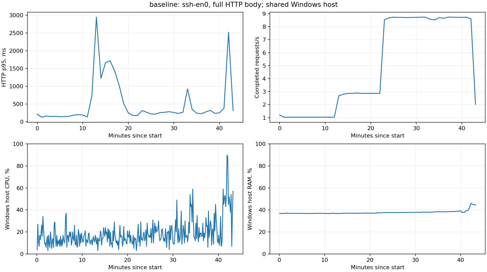

# Аудит InteractiveFoodMenu: Appwrite, 21 октября 2026

**Работа остановлена по просьбе пользователя 21.10.2026 в 13:16 МСК.** Исправления сохранены в ветке `codex/appwrite-audit-fixes`, функциональные проверки завершены. Длительный baseline прерван; длительный прогон кандидата, сравнение производительности «до/после» и итоговая сверка статистики нагрузки не выполнены. Автоматического продолжения нет.

## Состояние приложения и стенда

- Baseline — `d542fe8`; кандидат — изменения ветки `codex/appwrite-audit-fixes` на этой основе. На момент остановки испытаний публикации не было; последующая отправка этой ветки согласована пользователем отдельно. Production не обновлялся.
- Прежняя рабочая версия запущена по согласованию. После остановки тестов рабочий API отвечает **200**. Остановлены **17 контейнеров** проектов `ifm-audit-menu` и `ifm-audit-appwrite`; работающих тестовых контейнеров **0**. Тестовые тома и снимок seed сохранены.
- Остановлены генератор, контроллер перехода baseline → candidate, ресурсный сборщик, локальный mock и SSH-туннель. Следующий этап не запускался.
- В приложении сохранён Appwrite. Незавершённые изменения PostgreSQL/SSE исходной рабочей копии в кандидат не включены. Внутренняя PostgreSQL самого Appwrite не означает миграцию приложения.

[Runbook](../../audit-runbook.md) описывает воспроизведение. Секреты, fixture, cookie, PIN, пароли, env и URL-фрагменты экранов в отчёт и экспорт не включены.

## Исправления и функциональная проверка

Исправлены отзыв staff-сессий, неполный массовый отзыв экранов, конкурентное подключение одного QR и неверная статистика переходов доступности. Добавлены сериализация изменений одной позиции в текущем единственном API-процессе, staff-доступ к версии своего меню, обновление кабинета при изменениях другого сотрудника, защита повторных действий, 15-секундный таймаут и перечитывание после неизвестного результата записи. Android получил остатки и согласованный CSV-импорт. Дополнительно исправлены нормализация ключей ограничения входа и обработка временных отказов Appwrite. Детали — в [реестре дефектов](defects.md).

| Проверка | Baseline | Кандидат |
| --- | --- | --- |
| Функциональные группы на настоящем тестовом Appwrite | 1/12 прошла | **12/12 прошли** |
| Очистка временных данных функциональных проверок | Успешно | Успешно |
| Backend unit/HTTP | — | **56/56**, без пропусков |
| Web unit/component/API | — | **83/83** |
| Android unit | — | **16/16** |
| Сборка backend, modern/legacy web, Android debug APK | — | Успешно |
| Тесты инструментария нагрузки и сверки | — | **21/21** |
| Backend mutation gate | — | **76,79%**, порог 75%; 86 killed, 26 survived, 0 timeout/error |
| Покрытие backend | — | Строки/операторы 73,92%; ветви 71,66%; функции 87,28% |

12 групп не равны 12 самостоятельным багам: они охватывают четыре основных семейства дефектов, новую возможность `/menu/version` для сотрудника и проверки отсутствия регрессий. Восстановление QR на реальном Appwrite проверено из заранее созданного промежуточного состояния; аварийное завершение между двумя записями отдельно не выполнялось. Локальный HTTP-тест покрывает инъекцию такой ошибки.

Реальный baseline выполнен 21.10 в 11:28–11:29 МСК, кандидат — в 11:32–11:33 МСК. Доказательства: [baseline](evidence/regressions-baseline-20261021.json), [кандидат](evidence/regressions-fixed-20261021.json), [сводка проверок](evidence/validation.json).

## Браузер и Android

На кандидате с настоящим Appwrite современный Chromium подтвердил единственный stock POST при двойном нажатии с задержкой 800 мс, обновление второго кабинета без ручной перезагрузки, отсутствие горизонтального переполнения при ширине 390 px, сохранение серверного ТВ-меню при потере сети и восстановление связи. Modern и React legacy отрисованы; legacy использовал whatwg-fetch поверх XHR.

Android APK собран. В эмуляторе API 35 с локальным HTTP mock проверены остатки 1 → 0 → 1, запрет минуса при нуле, абсолютное количество, два импорта CSV без дубликата, сохранение количества при изменении цены и потерянный ответ после применения записи: один POST, перечитывание результата, предупреждение, без автоматического повторного списания. Это **не проверка Android на реальном Appwrite или физическом устройстве**.

[Снимки и точные границы](browser/README.md), [безопасный Android-журнал](evidence/android-mock-actions.jsonl). Прямая XHR-ветка без fetch/polyfill, окончательная визуальная проверка modern после анимации, дополнительные сценарии перерыва/пагинации и физический старый ТВ остались непроверенными. Снимок modern во время анимации не используется для приёмки расположения строк.

## Условия частичного нагрузочного прогона

Отдельный Appwrite **2.2.0**, Redis, API и web на Windows 11/Docker 29.9.1; Ryzen 9 9950X, 32 логических процессора, 64 ГБ установленной RAM. Ограничения WSL: 50 ГБ RAM, 15 vCPU, 50 ГБ swap. Лимиты тестовых API/web — 512/128 МиБ. Полные идентификаторы образов и фактические лимиты сохранены в ledger экспорта.

Синтетические данные: **10 точек, 100 аккаунтов, 1780 позиций**, меню по 60, 300 и 1000 позиций; 100 000 исходных событий за 30 дней. 50 основных экранных сессий: 30 серверных ТВ с интервалом 15 с, 10 современных с проверкой версии каждые 5 с, 10 React legacy с запросом меню каждые 5 с. Резерв до 200 сессий был подготовлен, но стресс-этапы не выполнены. При 50 экранах работали 10 моделируемых сотрудников и два оператора.

Генератор работал с Mac через **SSH (`ssh-en0`)**, а не из LAN серверного ПК. Пользователь согласовал завершение SSH-замеров с отдельной оценкой серверного времени. Полное HTTP-время включает получение тела ответа; серверное время измеряется API от входа в middleware метрик до `finish`. Разница также включает транспорт и прочее время вне этого измерения; вычитать квантили как точную «задержку SSH» нельзя.

Хеш инструментария: `f2708bb29ba36561c310123cd3416aa32b8e61a46a2ce46d0e83bc71b40f4dc3`. Тестовые данные, транспорт и профиль зафиксированы в manifest. Сравнимого длительного результата кандидата нет.

## Измеренные результаты baseline

**21.10.2026, 12:32:50–13:16:07 МСК: 43 мин 17 с, 13 063 запроса, все HTTP 200, неожиданных ошибок 0.** Получено около 379 МБ тел ответов. Общие p50/p95/p99 полного HTTP: **89,02 / 504,46 / 1430,74 мс**; серверного времени: **51 / 137 / 410 мс**.

| Этап | Фактическая длительность | Запросов | HTTP p95, мс | API p95, мс | Состояние |
| --- | ---: | ---: | ---: | ---: | --- |
| Разогрев, 10 экранов | 3 мин | 186 | 154,38 | — | Завершён |
| 10 экранов | 10 мин | 620 | 193,32 | 69 | Завершён |
| 25 экранов | 10 мин | 1707 | 1469,57 | 103 | Завершён |
| 50 экранов | 10 мин | 5224 | 260,84 | 101 | Завершён |
| reload50 | 1 мин | 509 | 922,93 | 741 | Завершён |
| Час при 50 экранах | **9 мин 16 с из 60 мин** | 4807 | 386,08 | 121 | Остановлен пользователем |
| 100/200 экранов | — | — | — | — | Не запускались |

На завершённой десятиминутной ступени 50 экранов получено **8,71 запроса/с**. Это наблюдаемая нагрузка данного сценария, не максимальная производительность сервера.

| Маршрут, 50 экранов | Запросов | Полный HTTP p95, мс | Серверный API p95, мс |
| --- | ---: | ---: | ---: |
| Меню сотрудника | 400 | 247,48 | 70 |
| Меню экранов JSON | 1400 | 271,44 | 102 |
| Версия современного экрана | 1186 | 222,27 | 63 |
| Состояние серверного ТВ | 1170 | 175,08 | 48 |
| HTML-меню ТВ | 628 | 544,33 | 399 |
| Изменение остатка | 120 | 166,52 | 84 |
| Наличие | 40 | 172,74 | 103 |
| Цена | 20 | 142,06 | 85 |
| Перерыв | 20 | 168,50 | 72 |
| Статистика Hub | 40 | 165,56 | 70 |

На других этапах пороги полного HTTP-времени нарушались: например, на 25 экранах p95 меню сотрудника **2102 мс** при пороге 500 мс; в незавершённом часовом этапе p95 изменения наличия **2484 мс** при пороге 1000 мс. Результат не объявляется прошедшим приёмку. Серверные метрики позволяют отличить такие эпизоды от времени выполнения обработчиков, но сами по себе не доказывают причину каждого замедления.

В стадии reload50 одновременно запрашивались полные динамические меню. Статические JS/CSS/шрифты, загрузка браузерных страниц и физический рендеринг нагрузочным генератором не измерялись. Действия сотрудников в основном профиле распределены по времени; дополнительный burst с одновременным обновлением всех десяти точек не запускался.

### Ресурсы и Appwrite

Сохранено **310 ресурсных отсчётов** строго за интервал нагрузки. CPU Windows: p95 **45%**, максимум **90%**; RAM хоста — максимум **45,94%**; максимум дисковой очереди — **4**. OOM, перезапуски тестовых контейнеров, ресурсные аварийные сигналы и провалы health рабочего API в этом интервале не зарегистрированы. Это показатели общего Windows-хоста, а не только приложения.

Все **13 063** нагрузочных request ID сопоставлены с API-логами. Зафиксировано **64 470 SDK-вызовов Appwrite**; суммарное время SDK — **1 006 318 мс**. Оно суммирует параллельные вызовы и не является стеночным временем БД. Один временный сбой чтения ресурсного статуса был перенесён с сохранением предела свежести последнего валидного отсчёта.

Последняя минутная корзина графика неполная из-за остановки; её RPS не следует интерпретировать как спад пропускной способности.

### Доставка и целостность: что осталось недоказанным

Успешно возвращены **557 изменений**. Получено **2355 подтверждений содержимого**, p95 задержки **14,21 с** с разными интервалами опроса клиентов. Зарегистрированы **14 превышений polling + 2 с**: 4 на 25 экранах и 10 в reload50. Это нарушения критерия, а не успешная доставка в срок.

Ещё **22 ожидаемых подтверждения** отсутствовали на момент остановки. Финальный grace-период не выполнялся, поэтому их нельзя автоматически считать потерянными обновлениями приложения. Генератор пропустил **6 запланированных запусков** на стадии 25 экранов при занятости акторов/лимите параллелизма; это не шесть доказанных потерянных записей API.

Остановка отменила финальную проверку остатков и after-snapshot. Сверка «журнал успешных действий → итоговое меню → события статистики» для этого прогона **не выполнена**. Отсутствие HTTP-ошибок не доказывает отсутствие потерь данных. Функциональные проверки конкурентных остатков и статистики кандидата отдельно прошли на настоящем Appwrite.

## Сохранённые артефакты и невыполненная часть

[JSON summary](evidence/full-baseline-summary.json), [manifest](evidence/full-baseline-manifest.json), [ресурсы](evidence/full-baseline-resources.json), [API-сводка](evidence/full-baseline-api.json), [контрольные суммы](evidence/index.json). Полный безопасный экспорт JSON/CSV, HTML, серверных метрик, ledger, графиков и прерванных попыток находится в `output/audit/2026-10-21`; архив — `output/audit/audit-20261021.zip` рабочего дерева аудита. Эти объёмные данные исключены из Git.

Ранний короткий baseline 20.10: **849 запросов, 0 ошибок**, 152/152 подтверждения, 10/10 итоговых остатков. Он не заменяет длительный прогон. Его [summary](evidence/quick-baseline-20261020-summary.json) и [manifest](evidence/quick-baseline-20261020-manifest.json) сохранены отдельно.

Предыдущие прерванные попытки исключены из сравнения: перезапуск тестового ClickHouse из-за недопустимого имени пользователя; чрезмерно строгая реакция прежнего harness на единичный сбой ресурсного HTTP; разрыв SSH. Исправления инфраструктуры касались только тестового стенда. Эти причины не выданы за баги приложения.

По просьбе пользователя не выполнялись: полный час, стресс 100/200, длительный кандидат и сравнение «до/после», окончательная сверка агрегатов нагрузки, аварийные перезапуски тестовых служб, отдельный staff-polling supplement, дополнительный burst, Android на настоящем Appwrite, дополнительные браузерные сценарии и отдельная проверка лимитов на настоящем Redis. Подготовленные временные helpers для этих дополнений не считаются проверенным результатом.

## Предложения по бизнес-процессам

| Приоритет | Возможность | Трудоёмкость, рабочих дней | Как измерять эффект |
| --- | --- | ---: | --- |
| 1 | Приёмка и журнал движений: завоз, списание, возврат, корректировка | 5–8 | Время сверки смены, необъяснённые корректировки |
| 2 | Минимальные остатки и предупреждения | 2–4 | Время реакции, длительность отсутствия позиции |
| 3 | Контроль применённой версии меню на экранах | 3–5 | Минуты устаревших цен, время выявления проблемы |
| 4 | Шаблоны и расписания, черновик и публикация | 8–12 | Время обновления точек, число повторных исправлений |
| 5 | Чек-лист открытия и передачи смены | 3–5 | Время передачи, забытые задачи и расхождения |

Это предложения, функции не реализовывались. Оценки даны для одного знакомого с проектом разработчика; экономия пока не измерена. Подробности — в [документе по бизнес-процессам](../../audit-business-processes.md). Операционная статистика меню не является продажами: для них нужен кассовый источник.
